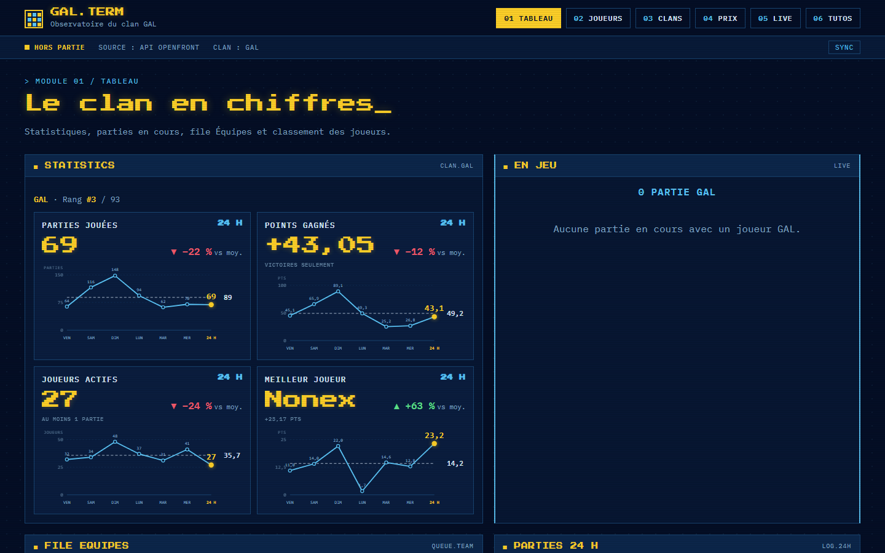
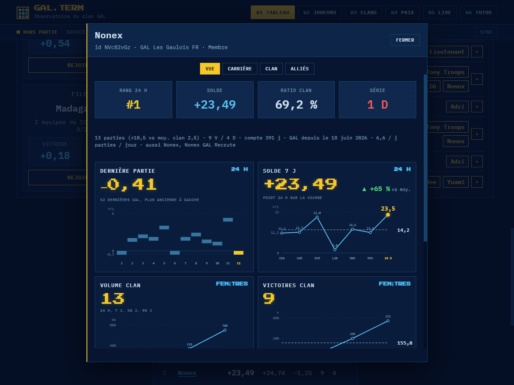

<p align="center">
  
</p>

<p align="center">
  <a href="https://gal.ciriushub.fr"></a>
  
  
</p>

<p align="center"><b>GAL.TERM</b> est l’observatoire du clan <b>GAL</b> sur OpenFront.<br>
Tableau live, file Équipes, parties 24 h, classements, fiches joueurs — tout ce dont le clan a besoin, rien d’un client de jeu.</p>

<p align="center"><a href="https://gal.ciriushub.fr">Ouvrir le site →</a></p>

---

## Le radar



Le terminal du clan : stats, file, parties, classement. Un clic sur un pseudo ouvre la fiche.



Pseudo, identifiant, solde, série, volume 24 h → 90 j, dernières cartes. Pas d’ID en titre. Pas de graphes vides.

## Ce que ça fait

| Module | Ce que tu vois |
| --- | --- |
| **Tableau** | Rang clan, parties en cours, file Équipes, log 24 h, classement solde / V / D / ratio |
| **Fiche joueur** | Clic sur un pseudo · rang, solde, forme, fenêtres 7 / 30 / 90 j, carrière, alliés |
| **Joueurs** | Roster GAL, rôles, dates d’entrée, totaux par mode |
| **Clans** | Classement de saison, occupation, points |
| **Live** | Streams du clan |
| **Tutos** | Guides |

Les chiffres clan viennent des sessions GAL et de l’API publique OpenFront.

## Architecture

```
OpenFront API          Node 127.0.0.1:47331         OVH
─────────────          ────────────────────         ───
/public/clan/GAL  →    server.js  → public/    →    ovh/  gal.ciriushub.fr
sessions · ranks       snaps + live WS              PHP + cache
players · hub          watchdog 5 min               gate anti-bot
```

- **Local** — `server.js` sert le terminal, pousse les snaps, tient le live.
- **Public** — `ovh-build.js` transforme le front pour PHP. Même UI, sans WebSocket.
- **Garde** — mot de passe + preuve JS. Les secrets restent hors git.

## Lancer en local

Prérequis : Node.js 20+.

```bash
cd of-deck
node server.js
```

Ouvre [http://127.0.0.1:47331](http://127.0.0.1:47331).

Au premier lancement, un mot de passe est écrit dans `.access.json` (ignoré par git).

Keep-alive Windows (optionnel) :

```powershell
.\install.ps1
```

Tâche planifiée `OF-Deck`, watchdog caché toutes les 5 minutes. Un fichier `DISABLED` à la racine coupe tout.

## Déployer

```bash
node ovh-build.js
```

Ça produit `ovh/` : JS/CSS versionnés, appels `/api/*` remplacés par du PHP, live en pull.

Copie `ovh/api/config.example.php` vers `ovh/api/config.php`, renseigne mot de passe et clé live, envoie le dossier sur l’hébergement.

## Arborescence

```
public/          terminal (HTML, CSS rétro, JS)
ovh/             build PHP prêt à uploader
  api/           clan, ranks, players, live, gate
server.js        radar local
directory.js     annuaire des joueurs croisés
ovh-build.js     public/ → ovh/
watchdog.ps1     relance silencieuse
docs/            visuels du README
```

## Stack

Navy `#040e25` · or `#fccf28` · cyan `#5cc5f7` · police pixel + mono · zéro arrondi.

Vanilla JS, Node http, PHP 8, API publique OpenFront.

## Licence

Voir [LICENSE](LICENSE). Usage clan GAL, pas un client de jeu.
